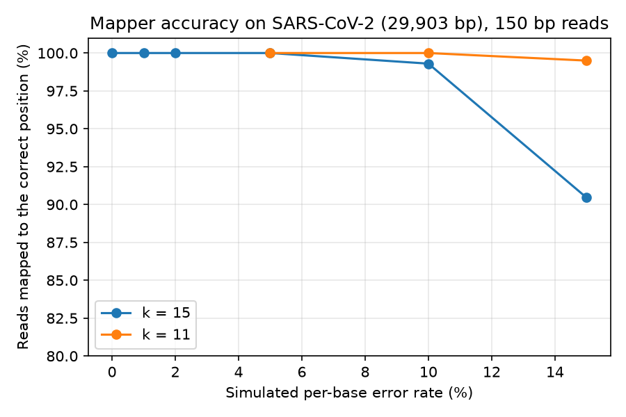
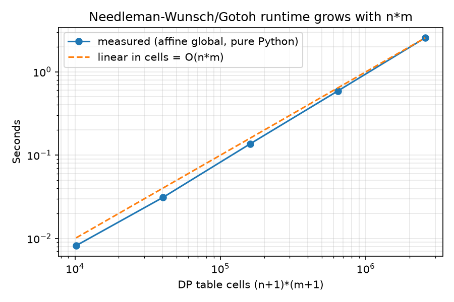

# dna-aligner-from-scratch

[](https://github.com/zainab-123-spec/dna-aligner-from-scratch/actions/workflows/tests.yml)


Sequence alignment and short-read mapping **written from scratch in plain Python**,
with no alignment libraries and no third-party dependencies in the package:

| Piece | What it does | Cost |
|---|---|---|
| Needleman-Wunsch | best alignment of two *whole* sequences | O(n·m) |
| Smith-Waterman | best matching *piece* of two sequences | O(n·m) |
| Gotoh affine gaps | opening a gap costs more than extending it (3 DP tables) | O(n·m) |
| BLOSUM62 + match/mismatch | protein and DNA scoring | - |
| k-mer index | hash map `k-mer -> positions` over a genome | build O(L), lookup O(1) |
| Seed-and-extend mapper | k-mer seeds -> diagonal voting -> banded Smith-Waterman, both strands | ~O(read · band) per candidate |
| FASTA / FASTQ, read simulator, CLI | `dnaalign align`, `dnaalign map`, `dnaalign simulate` | - |

New to these ideas? Read **[LEARNING_GUIDE.md](LEARNING_GUIDE.md)** - it explains
everything in simple English, with interview questions and answers.

## Results (real measurements)

All numbers below were produced by the scripts in `benchmarks/` on 2026-10-31
(Python 3.13, one core of an Intel Xeon VM). Raw JSON is in `benchmarks/results/`.

**1. Correctness vs Biopython.** On 3,000 random cases (DNA and protein, global and
local, linear and affine gaps, BLOSUM62) the scores from `dnaalign` were **identical to
Biopython's `PairwiseAligner` in 3,000 / 3,000 cases**, and every traceback re-scores to
exactly the reported score.

**2. Read mapping on a real genome.** Reference: SARS-CoV-2 Wuhan-Hu-1
(NCBI `NC_045512.2`, 29,903 bp). 2,000 simulated 150 bp reads per row, random strand,
errors = 90% substitutions + 10% insertions/deletions. "Correct" = right strand and
within 10 bp of the true start.

| Error rate | Correct (k=15) | Precision (k=15) | Reads/s (k=15) | Correct (k=11) | Reads/s (k=11) |
|---:|---:|---:|---:|---:|---:|
| 0% | 100.0% | 100% | 192 | - | - |
| 1% | 100.0% | 100% | 196 | - | - |
| 2% | 100.0% | 100% | 198 | - | - |
| 5% | 100.0% | 100% | 203 | 100.0% | 57 |
| 10% | 99.3% | 100% | 199 | 100.0% | 60 |
| 15% | 90.5% | 100% | 223 | 99.5% | 60 |

Building the k-mer index for the whole genome takes **0.02 s**. Every read that the
mapper reported was in the correct place (precision 100%); misses at high error rates
are reads left *unmapped* because no exact 15-mer survived. Smaller seeds (k=11) recover
them but are ~3.3x slower because more random seed hits must be checked - the classic
sensitivity/speed trade-off.



**3. O(n·m) in practice.** Global affine alignment of two random sequences of length n:
100 -> 0.008 s, 200 -> 0.031 s, 400 -> 0.137 s, 800 -> 0.587 s, 1600 -> 2.55 s.
Doubling n multiplies the time by ~4, exactly as O(n·m) predicts.



## Install and use

```bash
git clone https://github.com/zainab-123-spec/dna-aligner-from-scratch
cd dna-aligner-from-scratch
pip install -e ".[dev]"      # package has no deps; dev = pytest, ruff, biopython
pytest                        # run the test suite
```

Align two sequences (literal strings or FASTA files):

```text
$ dnaalign align GATTACA GCATGCU --gap-open -1 --gap-extend -1
G-ATTACA
| | |.|.
GCA-TGCU
score = 0
cigar = 1M1D1M1I4M  identity = 50.0%

$ dnaalign align HEAGAWGHEE PAWHEAE --mode local --matrix blosum62
```

Simulate reads and map them:

```text
$ dnaalign simulate --ref benchmarks/data/NC_045512.2.fasta -n 1000 --error-rate 0.02 --out reads.fq
$ dnaalign map --ref benchmarks/data/NC_045512.2.fasta --reads reads.fq --out hits.tsv
indexed 29,903 bp in 0.02s; mapped 1000/1000 reads in 5.02s
$ head -3 hits.tsv
read    mapped  strand  pos    score  mapq  cigar
read0_pos27670_strand-  1  -  27671  288  60  150M
read1_pos1902_strand+   1  +  1903   268  60  92M1D57M
```

From Python:

```python
from dnaalign import global_align, local_align, Scoring, blosum62, ReadMapper

aln = global_align("ACGTTACG", "ACGTACG", Scoring(match=1, mismatch=-1, gap_open=-3, gap_extend=-1))
print(aln, aln.cigar())

mapper = ReadMapper(genome_sequence, k=15)
hit = mapper.map_read("read1", "ACGT...")
print(hit.strand, hit.position, hit.cigar, hit.mapq)
```

## Reproduce the results

```bash
pip install -r requirements.txt && pip install -e .
python benchmarks/validate_vs_biopython.py --cases 3000
python benchmarks/benchmark_mapper.py --error-rates 0 0.01 0.02 0.05 0.10 0.15
python benchmarks/benchmark_mapper.py -k 11 --error-rates 0.05 0.10 0.15 --dp-sizes 100 \
       --out benchmarks/results/mapper_benchmark_k11.json
python benchmarks/make_figures.py
```

## Project layout

```text
src/dnaalign/
  scoring.py      match/mismatch, gap penalties, BLOSUM62 loader
  align.py        Needleman-Wunsch, Smith-Waterman, Gotoh, banded alignment, traceback, CIGAR
  kmer_index.py   k-mer hash index, reverse complement
  mapper.py       seed -> vote -> banded extend read mapper
  simulate.py     read simulator with substitutions and indels
  seqio.py        FASTA/FASTQ readers and writers
  cli.py          dnaalign align | map | simulate
tests/            pytest suite (incl. score checks against Biopython)
benchmarks/       validation, mapping benchmark, figures, SARS-CoV-2 reference
```

## Limitations (honest notes)

- Pure Python is ~100-1000x slower than C tools like BWA or minimap2; the goal is clarity.
- One reference sequence at a time; no SAM/BAM output; mapping quality is a simple
  best-vs-second-best heuristic.
- Reads are simulated (uniform errors), which is easier than real sequencer data.

## References

- Needleman & Wunsch (1970) *J Mol Biol* 48:443-453.
- Smith & Waterman (1981) *J Mol Biol* 147:195-197.
- Gotoh (1982) *J Mol Biol* 162:705-708.
- Henikoff & Henikoff (1992) *PNAS* 89:10915-10919 (BLOSUM).
- Li (2018) *Bioinformatics* 34:3094-3100 (minimap2, seed-chain-extend).

## License

MIT (c) Zainab Javed
